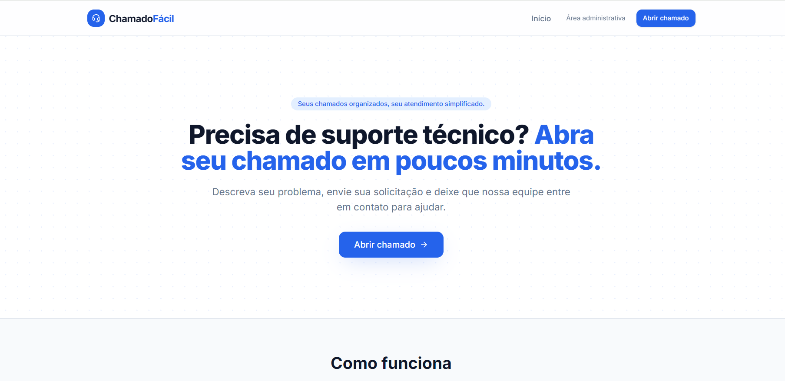
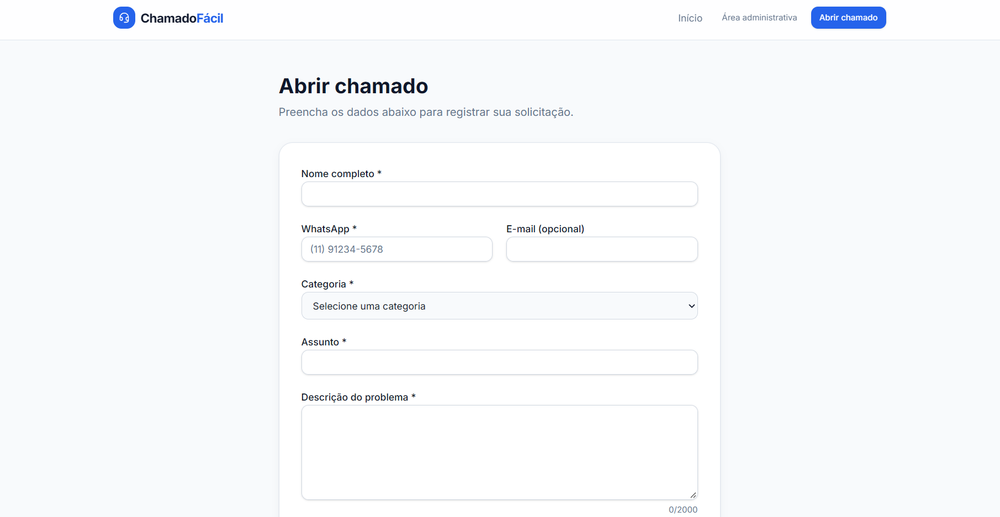
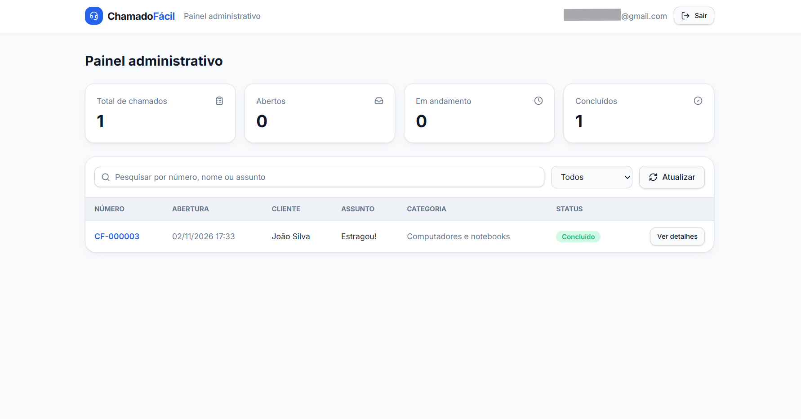
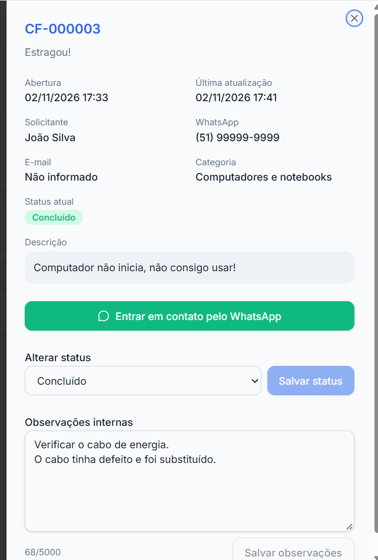

# ChamadoFácil

**Seus chamados organizados, seu atendimento simplificado.**

[**Acessar o MVP publicado**](https://chamadofacilmvp.lovable.app/)

> Projeto desenvolvido no curso de vibe coding da DIO, utilizando ChatGPT para definição e especificação do MVP e Lovable para implementação. É uma demonstração funcional, não um serviço comercial de suporte técnico.

## 1. Problema e oportunidade

Profissionais autônomos e pequenas empresas de suporte de TI frequentemente recebem pedidos por mensagens e precisam registrar manualmente o que foi solicitado, quem solicitou e se o atendimento foi concluído. A dispersão dessas informações dificulta o acompanhamento e pode levar à perda de solicitações.

O **ChamadoFácil** propõe uma alternativa simples: uma página pública para abertura de chamados e uma área administrativa para acompanhar o trabalho. A solução é direcionada inicialmente a um único prestador de serviços de TI, como prova de conceito para um SaaS futuro.

A oportunidade é plausível, mas **não foi comercialmente validada**. Segundo a Pesquisa Pulso dos Pequenos Negócios, divulgada pelo Sebrae em 16/04/2026, 82% dos MEIs e das micro e pequenas empresas indicaram o WhatsApp como seu principal canal de comunicação e vendas. Esse dado contextualiza o problema de comunicação, mas **não mede a demanda pelo ChamadoFácil**.

Fonte: [Sebrae — WhatsApp se consolida nas vendas on-line (16/04/2026)](https://agenciasebrae.com.br/dados/whatsapp-se-consolida-nas-vendas-on-line-enquanto-facebook-e-lojas-proprias-perdem-folego/).

## 2. Tese e hipóteses do MVP

**Tese:** prestadores de serviços de TI que acompanham solicitações de maneira informal podem perceber valor em uma ferramenta acessível que concentre pedidos, estados e contatos.

Hipóteses a testar com usuários reais:

1. Um cliente consegue abrir um chamado sem precisar criar uma conta ou receber assistência.
2. Um prestador consegue acompanhar os pedidos com mais clareza do que somente pelo WhatsApp.
3. O registro de status e observações reduz dúvidas sobre o andamento do atendimento.
4. Parte dos prestadores consideraria pagar uma mensalidade pela solução.

As três primeiras hipóteses podem ser investigadas por observação e entrevistas; a quarta exige validação de disposição real a pagar, idealmente com proposta comercial concreta.

## 3. Tamanho de mercado — TAM, SAM e SOM

**Não há, neste projeto, uma contagem oficial apurada de empresas elegíveis especificamente ao ChamadoFácil.** Os números a seguir são **cenários exploratórios**, para demonstrar a metodologia de dimensionamento, e **não estimativas estatísticas comprovadas**.

Modelo ilustrativo baseado em prestadores potencialmente atendíveis e preço hipotético de **R$ 39/mês por assinatura**:

| Indicador | Premissa ilustrativa | Potencial anual hipotético |
|---|---:|---:|
| **TAM** — mercado total endereçável | 100.000 prestadores de serviços de TI no Brasil | R$ 46.800.000 |
| **SAM** — parcela alcançável pelo produto inicial | 10.000 desses prestadores | R$ 4.680.000 |
| **SOM** — participação que se pretende conquistar inicialmente | 100 assinantes | R$ 46.800 |

Cálculo: **número de assinantes × R$ 39 × 12 meses**. O SOM representa um objetivo hipotético, não uma previsão de receita. A passagem de TAM para SAM pressupõe restrições de perfil, acesso digital, interesse e canais de aquisição, **ainda não mensuradas**.

Para transformar esses cenários em estimativas sustentáveis seria necessário levantar o número de estabelecimentos e profissionais nas CNAEs relevantes (por exemplo, reparação e manutenção de computadores e suporte em TI), identificar sobreposição e informalidade, entrevistar o público e testar preços. As tabelas por CNAE do [Cadastro Central de Empresas — IBGE](https://www.ibge.gov.br/estatisticas/economicas/industria/9016-estatisticas-do-cadastro-central-de-empresas) são uma possível fonte para uma análise futura. Não se deve interpretar o total geral de empresas de serviços como a quantidade de compradores deste produto.

## 4. Business Model Canvas

| Bloco | Proposta inicial |
|---|---|
| **Segmentos de clientes** | Técnicos autônomos de TI e pequenas empresas de suporte técnico |
| **Proposta de valor** | Centralizar solicitações e acompanhar atendimentos sem a complexidade de um help desk corporativo |
| **Canais** | Landing page, indicações, redes sociais e contato direto com prestadores |
| **Relacionamento com clientes** | Onboarding simples, suporte inicialmente manual e coleta direta de feedback |
| **Fontes de receita** | Assinatura mensal futura; valor ainda não validado |
| **Recursos principais** | Aplicação web, Lovable Cloud, código-fonte e conhecimento do processo de atendimento |
| **Atividades principais** | Desenvolvimento, manutenção, suporte, aquisição e validação de clientes |
| **Parcerias principais** | Provedores de infraestrutura e potenciais parceiros de indicação |
| **Estrutura de custos** | Hospedagem, infraestrutura, domínio, manutenção, atendimento e aquisição de clientes |

## 5. Escopo do MVP

### Funcionalidades previstas e exercitadas pelo autor

- Landing page pública e responsiva.
- Formulário público de abertura de chamados com nome, WhatsApp, e-mail opcional, categoria, assunto e descrição.
- Persistência dos chamados no backend Lovable Cloud.
- Login e painel administrativo com indicadores e listagem.
- Consulta de detalhes, atualização de status e observações internas.
- Contato via WhatsApp com mensagem pré-preenchida.

**Status:** Aberto, Em andamento, Concluído e Cancelado.

O autor relatou ter realizado os testes principais do checklist funcional. Esta documentação não substitui uma auditoria independente do código e das políticas de banco.

### O que foi deixado manual deliberadamente

- Contato com o solicitante e negociação pelo WhatsApp.
- Execução e acompanhamento operacional do suporte técnico.
- Cobrança e envio de eventual link de pagamento.
- Pesquisa com clientes e validação de preços.

### Fora de escopo nesta versão

Multiempresa, planos e pagamentos, integração com WhatsApp Business API, notificações, chat, anexos, cadastro de técnicos, SLA e relatórios avançados.

## 6. Tecnologias e arquitetura

- **Frontend:** aplicação web gerada pelo Lovable (ver dependências reais em `package.json`).
- **Backend:** Lovable Cloud, banco de dados e autenticação nativos.
- **Integração externa:** link `wa.me` para iniciar uma conversa, sem envio automático.
- **Versionamento:** GitHub, via sincronização do Lovable.

As dependências e a organização real do código estão no próprio repositório, e prevalecem sobre esta descrição resumida.

## 7. Desenvolvimento assistido por IA

O ChatGPT foi utilizado como parceiro de planejamento para selecionar a ideia, comparar alternativas, formular a tese de negócio e detalhar requisitos, UX, segurança, modelo de dados e critérios de aceite. O Lovable foi utilizado para gerar a implementação a partir de um mega prompt consolidado.

- [Especificação e mega prompt utilizado](docs/mega-prompt.md)
- Correções posteriores via prompt: **nenhuma informada até o momento**. Caso sejam feitas, documentar aqui o texto exato e o objetivo.
- Decisão de economia de créditos: restringir o MVP a um único prestador, um fluxo de chamados e funcionalidades essenciais; não gerar imagens por IA nem adicionar integrações externas.

## 8. Validação e segurança

- Aplicação publicada: https://chamadofacilmvp.lovable.app/
- Testes de abertura, administração, observações e status: **realizados manualmente pelo autor**, conforme seu relato.
- Lovable **Quick Security Scan:** aprovado, conforme verificação do autor.
- Lovable **Deep Security Scan:** nenhum problema identificado, conforme verificação do autor.

Uma varredura sem achados não equivale a garantia absoluta de segurança. Não publicar credenciais ou dados pessoais de clientes no repositório.

## 9. Evidências visuais

As capturas abaixo demonstram as principais funcionalidades
do MVP ChamadoFácil.

### Página inicial

Apresentação da plataforma e acesso à abertura de chamados.

### Abertura de chamado

Formulário público para registrar solicitações de suporte técnico.

### Painel administrativo

Visualização dos indicadores e gerenciamento dos chamados.

### Detalhes do chamado

Consulta das informações, atualização de status e observações.

## 10. Como testar

1. Acesse [a aplicação publicada](https://chamadofacilmvp.lovable.app/).
2. Abra um chamado usando dados fictícios e confira a confirmação.
3. Com uma conta administrativa autorizada, entre no painel.
4. Localize o registro, altere seu status e insira observações.
5. Recarregue a página e verifique a persistência.
6. Confirme o destino e o texto da opção de contato pelo WhatsApp sem enviar a mensagem.

## 11. Próximas evoluções

- Pesquisa de satisfação e validação de disposição a pagar.
- Perfis multiempresa e múltiplos administradores.
- Automação opcional de notificações.
- Histórico de interações e relatórios.
- Planos de assinatura e cobrança, somente após validação.

## 12. Observação sobre privacidade

O projeto é demonstrativo. Dados informados no formulário destinam-se à gestão do chamado. Para uso comercial real, revisar medidas de proteção contra abuso, política de privacidade, retenção dos dados e conformidade com a LGPD antes de captar solicitações de clientes reais.
